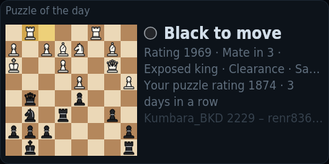
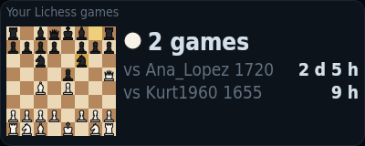
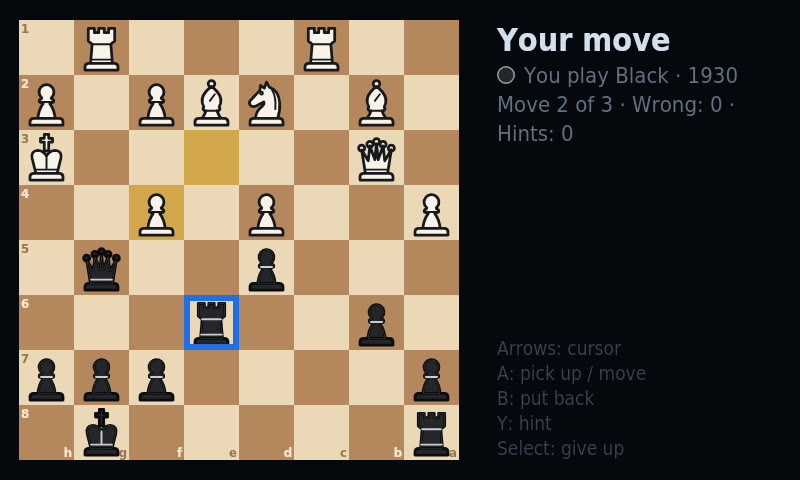

# kiosko-plugin-chess

The daily chess puzzle of Lichess on your panel: the position, its rating and themes, and its solution once you solve it; solve it from Kiosko’s Play page with a game controller or the keyboard. With a Lichess token, your puzzle rating and the games waiting for your move.

A plugin for [Kiosko](https://github.com/kiosko-lcd/kiosko), the widget mosaic for small USB LCD panels.



## Install

In Kiosko, **Plugins → Install from npm** → `kiosko-plugin-chess`, then restart Kiosko. Or from a terminal:

```sh
npm install --prefix ~/.config/kiosko/plugins kiosko-plugin-chess
```

(macOS: `~/Library/Application Support/Kiosko/plugins`, Windows: `%APPDATA%\Kiosko\plugins`.)

## Requirements

- Nothing to install. A Lichess account is optional (for your rating and your games); the daily puzzle needs none.

## What it does on your machine

- **Internet**: contacts `lichess.org`.

## Widgets

### Puzzle of the day — `chess/puzzle`

The daily puzzle of Lichess: the position from your side with the last move marked, whose move it is, its rating and themes. Once you solve it (or in the evening) the solution plays on the board. Solve it from Kiosko’s Play page with the “Chess puzzle” interlude.


Uses: `chess/lichess`.

| Option | Type | Default | |
|---|---|---|---|
| `board` | `wood` \| `slate` | `"wood"` | Board |
| `coordinates` | boolean | `true` | Coordinates. Letters and numbers on the edge squares, when they are big enough. |
| `reveal` | `evening` \| `solved` \| `never` | `"evening"` | Show the solution |
| `revealHour` | number | `20` | Solution from (hour) |
| `animate` | boolean | `true` | Play the solution on the board. One move every two seconds (a frame each). |

### Your Lichess games — `chess/games`

The Lichess games waiting for your move (correspondence and others), the most urgent one’s board and the time you have left. Needs a Lichess token in Settings → Data sources.



Uses: `chess/lichess`.

| Option | Type | Default | |
|---|---|---|---|
| `board` | `wood` \| `slate` | `"wood"` | Board |
| `coordinates` | boolean | `true` | Coordinates. Letters and numbers on the edge squares, when they are big enough. |

## Data sources

### Lichess — `chess/lichess`

The daily puzzle of Lichess, asked once a day; with a token, your puzzle rating and the games waiting for your move. Read every minute from what is kept here, Lichess itself only when something is due. Read every 1 min while a widget uses it. Options are set once in Kiosko → Settings → Data sources.

| Option | Type | Default | |
|---|---|---|---|
| `token` | string | *(secret)* | Lichess token (optional). Only for your puzzle rating and the games waiting for your move. Create one at lichess.org/account/oauth/token with “Read puzzle activity” and nothing else. The daily puzzle needs none. |
| `games` | boolean | `true` | Read my games in progress. With a token: the correspondence games waiting for your move, every 5 minutes. |

## Interludes

### Chess puzzle — `chess/play`

The daily puzzle of Lichess, to solve from Kiosko’s Play page with a game controller or the keyboard: move the cursor, pick a piece up (its legal moves are marked) and put it down. A wrong move shakes the board; a right one gets the opponent’s answer, until it is solved. Y gives a hint, Select twice gives up. At its time slot it shows the puzzle, and its solution once solved or in the evening. Add it in Kiosko → Screens → Interludes.



| Option | Type | Default | |
|---|---|---|---|
| `board` | `wood` \| `slate` | `"wood"` | Board |
| `coordinates` | boolean | `true` | Coordinates. Letters and numbers on the edge squares, when they are big enough. |
| `revealHour` | number | `20` | Solution at its time slot from (hour). With no one playing, the solution plays from this hour on (24: only once solved). |

## Playing it

Add the **Chess puzzle** interlude to a screen (Kiosko → Screens → Interludes),
then open Kiosko's **Play** page, pick that screen and press **Play**. With a
game controller, the keyboard, or the pad on the phone:

| Button | Keyboard | What it does |
|---|---|---|
| D-pad, L / R | arrows, WASD | move the cursor |
| A or X | Space, Enter | pick up the piece under the cursor (its legal moves are marked) / put it down |
| B | E, F | put the piece back |
| Y | Shift | hint: the piece to move is framed in green (again: the cursor goes to it) |
| Select | Tab, M | give up (press it twice): the solution plays out |
| Start | Esc | once it is over: solve it again |

A wrong move shakes the board and counts as a mistake; a right one gets the
opponent's answer, until it is solved. Any checkmate counts, as on Lichess,
even if it isn't the solution's. A pawn reaching the last rank opens a picker
(queen, rook, bishop, knight). What you did with each day's puzzle is kept in
the plugin's data folder (`solved.json`): the widget shows it, and the
solution, from then on.

## Lichess

The daily puzzle comes from Lichess's open API (`/api/puzzle/daily`, no key),
asked once a day (UTC) and kept in Kiosko's cache folder; if Lichess still
answers with yesterday's puzzle it is asked again an hour later. All requests
go one at a time with the plugin's User-Agent, and after a 429 none is made
until Lichess says. With a [token](https://lichess.org/account/oauth/token)
(the "Read puzzle activity" scope is enough), your puzzle rating (every 30
minutes) and the games waiting for your move (every 5 minutes) too. Kiosko
and this plugin are not affiliated with Lichess.

## The pieces

The piece set is the plugin's own, drawn for small panels: heavy silhouettes
with an outline that stays one pixel or more at any size, no inner detail
under 18 px squares. Two boards: wood and slate.

## Development

```sh
npm install
npm test          # node:test
npm run check     # TypeScript
npm run build     # dist/index.js, what Kiosko loads
```

To try it in a running Kiosko without publishing: `kiosko plugins link .` and restart Kiosko.

Working on Kiosko and its plugins together: clone them side by side
(`kiosko/` and `kiosko-plugins/kiosko-plugin-chess/`) and run `npm install` in
`kiosko/`; its workspaces link every plugin found in `../kiosko-plugins`.

## License

MIT. The bundled move generator, chess.js, is BSD-2-Clause: see [NOTICE](NOTICE).
